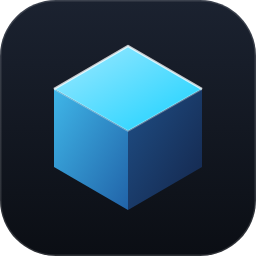
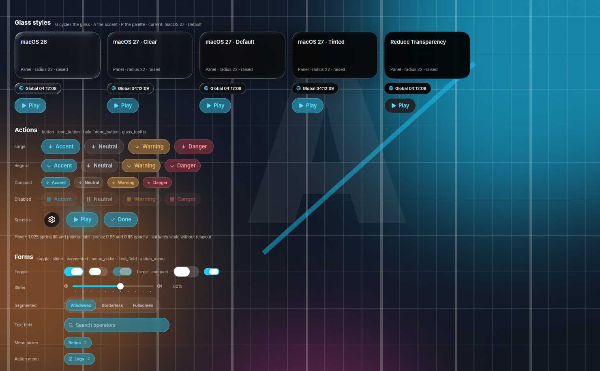

<div align="center">



# Calcite

**Liquid Glass for Rust.** Calcite is a glass UI library on [gpui-ce](https://github.com/gpui-ce/gpui-ce). It draws the macOS 26 and macOS 27 glass looks itself, so they look the same on macOS, Linux, and Windows.

[](https://github.com/LuMiSxh/Calcite/actions/workflows/ci.yml)
[](https://www.rust-lang.org/)
[](patches/)
[](LICENSE)
[](CHANGELOG.md)



**[Library guide](crates/calcite/README.md)** · [Changelog](CHANGELOG.md) · [Developer Preview](crates/calcite-showcase/src/bin/preview) · [Arknights Client](https://github.com/LuMiSxh/Arknights-MacOS-Client)

</div>

## Features

- Liquid Glass in one shader pass: lensing at the edge, dispersion, Fresnel rim, and specular light. The styles are macOS 26, macOS 27 Clear, Default, and Tinted, and Reduce Transparency.
- Actions, toggles, sliders, segmented controls, text fields, menus, choice cards, step rails, settings pages, modals, confirmation dialogs, banners, spinners, HUD pills, and a progress outline.
- Spring motion with SwiftUI `spring(duration:bounce:)` semantics. Press and hover scale without relayout.
- A palette you choose at compile time with a `const`, or replace at runtime. Theme changes crossfade.
- `Theme::follow_system` follows the OS light or dark appearance. `Theme::sync_reduce_motion` copies the app's Reduce Motion flag into the theme.
- Dynamic Theme: `calcite-tint` takes the accent from artwork, like the Arknights Client launcher.
- Keyboard focus rings, keyboard activation, and accessibility roles and labels.
- Window chrome like the launcher's hidden title bar: the traffic lights on macOS, caption buttons with Snap Layouts on Windows, and client-side decorations on Linux.
- Auto-updates: an Ed25519-signed feed, per-file zstd deltas (unchanged files cost nothing), verified staging, and install on quit.
- App icons outside a bundle, and `cargo calcite bundle` for DMG, Windows installers, deb, and AppImage.
- 2100+ [Lucide](https://lucide.dev) icons and an `icons!` macro for your own icons.

| Crate              | Contents                                                                                       |
| ------------------ | ---------------------------------------------------------------------------------------------- |
| `calcite`          | The UI library. See [its guide](crates/calcite/README.md).                                     |
| `calcite-tint`     | Dynamic theme colors from artwork. No dependencies, no UI code.                                |
| `calcite-bundle`   | `cargo calcite bundle`: `.app` and DMG, NSIS and MSI, deb and AppImage. Embeds the Windows icon. |
| `calcite-update`   | Signed updates with per-file deltas, staged next to the app and installed on quit. Sparkle's model on every platform. |
| `calcite-exec`     | Execution layer for views: `TaskSlot`, `ActivityStore` with leases, `Throttle`, `bounded`.     |
| `calcite-showcase` | `preview` (the Developer Preview: grouped component sections with variant and state matrices) and `home` (a launcher home screen with a simulated install). |
| `patches/`         | The gpui-ce patch that adds `Filter::Glass`, and the pinned gpui-ce commit.                    |

> [!NOTE]
> Calcite needs gpui-ce with the Liquid Glass patch. Upstream gpui-ce does not have `Filter::Glass` yet. Calcite is not affiliated with Apple, Zed Industries, or the gpui-ce maintainers.
>
> This project uses AI coding assistants.

## Set up and run

1. Install current stable Rust with `rustup` (tested with 1.97).
2. On macOS, install Xcode.
3. Fetch gpui-ce and apply the glass patch:

   macOS and Linux:

   ```sh
   ./scripts/bootstrap.sh
   ```

   Windows (PowerShell):

   ```powershell
   ./scripts/bootstrap.ps1
   ```

4. Start the developer preview or the home screen:

   ```sh
   just run
   just run home
   just run home ~/Pictures/artwork.jpg
   ```

   Without `just`, use `cargo run --release --bin preview` and `cargo run --release --bin home`.

   The preview can open on a section and a look. Put the flags after `--`:

   ```sh
   just run preview -- --section buttons --palette ember --reduce-motion
   ```

   `--section` takes a sidebar name (`buttons`, `forms`, `motion-lab`). `--palette` takes
   `arknights`, `ember`, or `light`. `--glass` takes `macos26`, `macos27-clear`,
   `macos27-default`, `macos27-tinted`, or `reduce-transparency`. `--reduce-motion` and
   `--reduce-transparency` start with those settings on. `preview --help` lists the flags; an
   unknown flag prints the usage and exits with status 2.

The first build compiles gpui-ce and takes several minutes. Run the bootstrap script again after
`patches/` changes.

### Keys

| Window  | Key       | Action                                              |
| ------- | --------- | --------------------------------------------------- |
| both    | G         | Next glass style                                    |
| both    | A         | Next accent (crossfades)                            |
| preview | P         | Next palette: Arknights, Ember, Light               |
| both    | M         | Toggle Reduce Motion                                |
| preview | [, ]      | Previous or next section in the sidebar             |
| preview | ?         | Show or hide the shortcut list (top right)          |
| home    | Space     | Primary action: Install, Pause, Resume, Play, Stop  |
| home    | 1, 2, 3   | Expand the music, version, or status pill           |
| home    | U         | Show the neutral "Install Update" button            |
| home    | O         | Toggle between your image and the procedural art; the accent follows the artwork |
| home    | H         | Show or hide the controls panel                     |
| both    | Command-Q | Quit                                                |

The letter keys are inactive while a text field has focus, so typing never triggers them. The
preview's list comes from the same `shortcuts!` table as its key bindings.

The preview's toolbar sets Dark or Light, Reduce Motion, Reduce Transparency, and the accent for
every section. The Light palette is the preview's own; the library's components still draw some
dark layers under it. Each section prints the Rust call of its components, and a unit test fails
when a `calcite::prelude` builder has no section.

## Updates

`calcite-update` follows Sparkle's model on macOS, Windows, and Linux:

1. The app downloads `update.json`: the feed and its Ed25519 signature. It checks the
   signature before it reads the feed, then the product, the channel, and the version.
2. The feed lists the complete new file tree with a SHA-256 per file, a full package, and
   deltas from older releases. A delta holds only new and changed files, as zstd patches
   against the installed files. Unchanged files, such as a bundled runtime, cost nothing.
3. The new tree is staged next to the app. Every file is checked against the signed tree.
   If the installed copy does not match, the update falls back to the full package.
4. When the app quits and nothing runs, the staged tree replaces the installed one with a
   rename. On Windows, each file moves aside first; `cleanup` removes the old files at the
   next launch.

Publish a release:

```sh
cargo install --git https://github.com/LuMiSxh/Calcite calcite-update --features publish
calcite-update keygen                                    # once; store the seed as a secret
calcite-update extract --feed old/update.json --package old/App-1.0.0-macos-aarch64.full.zst --into prev/1.0.0
calcite-update release --product dev.example.app --channel stable --version 1.1.0 \
	--name App --bundle target/calcite-bundle/release/App.app --out dist --previous 1.0.0=prev/1.0.0
calcite-update sign --feed dist/feed.json --out dist/update.json   # seed from CALCITE_UPDATE_KEY
```

Run `release` once per target into the same `dist` folder, then `sign` once. Upload
`dist/*` to the GitHub release; clients read `releases/latest/download/update.json`.

## Liquid Glass

Liquid Glass is not a blur. The look comes from the bezel, a curved edge that:

- bends the backdrop along the shape normal (lensing),
- splits red and blue slightly (dispersion),
- catches a thin Fresnel rim all around,
- throws a specular highlight on the side that faces the light, and a fainter one opposite.

The flat face in the middle shows the softly blurred, more saturated backdrop through a fill. Larger
surfaces read thicker: more lensing and a deeper shadow.

The patch adds this as `Filter::Glass` to gpui-ce's existing backdrop pipeline (downsample, gaussian
ping/pong, composite). Only the composite pass changes. It uses one SDF evaluation per pixel (four
more for the normal) and three backdrop samples. There is no extra render pass. gpui-ce writes its
shaders once in Rust (`wgsl_rs`) and generates WGSL, MSL, and HLSL at build time. So the same glass
code runs on Metal, Direct3D 11, and wgpu.

`calcite/src/glass.rs` chooses the parameters per system look:

| Style               | Backplate (neutral / chromatic, minimum tint) | Blur | Refraction | Notes                                    |
| ------------------- | --------------------------------------------- | ---: | ---------: | ---------------------------------------- |
| macOS 26            | none; the tint colors the glass               |  9   |     11     | Clear glass, strongest lensing           |
| macOS 27 · Clear    | 0.38 / 0.26, 0.20                             | 10   |      9     | The slider's clear end                   |
| macOS 27 · Default  | 0.68 / 0.44, 0.24                             | 13   |      7     | The launcher's macOS 27 branch           |
| macOS 27 · Tinted   | 0.86 / 0.64, 0.34                             | 16   |      5     | The slider's opaque end                  |
| Reduce Transparency | opaque 0.92 and an edge                       |  —   |      —     | No backdrop at all                       |

The pointer light (`PointerSheen` in the Swift app) is part of the same shader. Standard and large
capsule actions pass `window.mouse_position()` while hovered. Secondary actions use a flat surface
with the same light and no lensing.

## Execution layer

`calcite-exec` adds no runtime of its own. Work runs as ordinary GPUI tasks owned by a view. Results
reach state only through `Entity::update`. Each type maps to one Swift type in Arknights Client:

| Rust                                       | Swift                                      |
| ------------------------------------------ | ------------------------------------------ |
| `TaskSlot::replace`, `owns`, `invalidate`, `publish` | `TaskSlot.replace`, `owns`, `invalidate` |
| `ActivityStore::begin`, `update`, `end`    | `LauncherLifecycleStore` and `ActivityLease` |
| `Throttle::progress()`                     | progress throttling to about 10 Hz         |
| `bounded(limit, items, work)`              | windowed task group with an `AppConstants` limit |

The `home` binary shows the pattern. `start_transfer` claims a lease and replaces the slot's task.
It throttles raw progress and publishes only while its token owns the slot. Pause invalidates the
slot before it ends the lease.

## Verification status

| Check                                         | Result                                                    |
| --------------------------------------------- | --------------------------------------------------------- |
| Linux build, clippy, tests                    | Pass                                                      |
| Linux render (Xvfb, software Vulkan)          | Developer Preview and home render; screenshots reviewed             |
| macOS Metal backend (`cargo check --target aarch64-apple-darwin -p gpui_ce_apple`) | Compiles; not run on a Mac yet |
| Windows Direct3D backend                      | Not compiled (needs MSVC); the change mirrors the Metal one |
| gpui-ce shader ABI tests (`gpui_ce_render`)   | Pass                                                      |

## Known gaps

- Under Reduce Motion, SwiftUI pins the pointer light to the center. Calcite hides it instead.
- The parameters are tuned against renders on Linux, not against macOS 26/27 screenshots. Tune them
  on a Mac next.
- GPUI clips to rectangles, so client-side decorations on Linux cannot round full-bleed
  content. Round full-bleed images with `chrome::corner_radius`.
- The window chrome is verified on Linux only. Check the traffic lights and the Windows caption
  buttons on real systems.
- Calcite needs the patched gpui-ce. Push it to a fork with `scripts/publish-gpui-fork.sh` before
  you use Calcite as a Git dependency.
